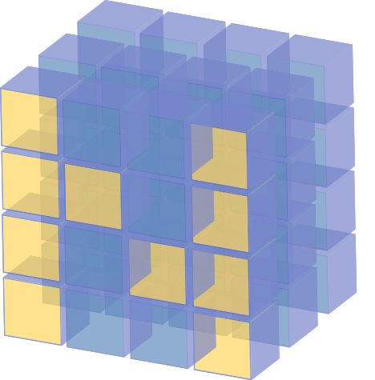
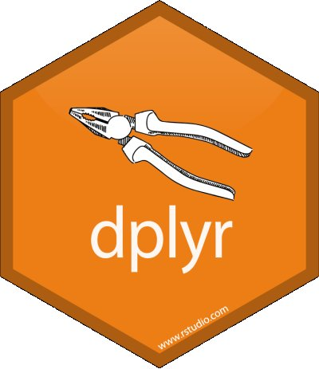
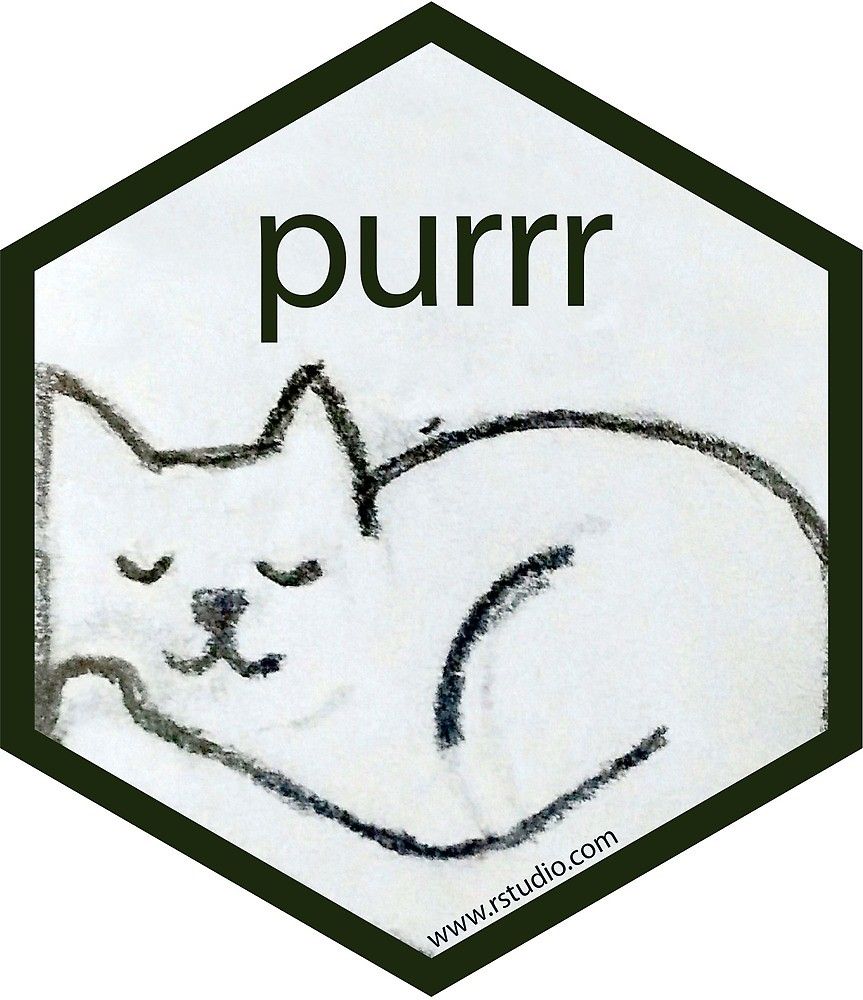
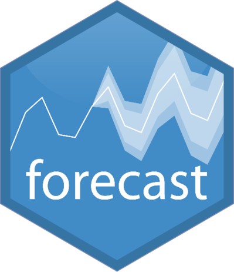
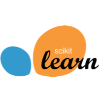
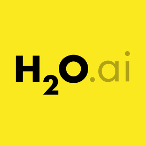
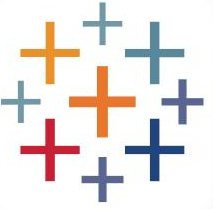
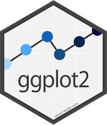

The tools and techniques I use, from statistical modelling to data platforms and AI agents.

#### Languages

   Python
   R
  · SQL · TypeScript · Bash

#### Data Wrangling

   pandas
   NumPy
   dplyr
   purrr

#### Statistical Modelling and Machine Learning

   forecast (time series)
   scikit-learn
   H2O

#### Data Visualisation and BI

   Tableau
   Qlik Sense
   ggplot2

#### Data Engineering and Cloud
AWS serverless data lakes · data-mesh ingestion · SAP and OData extraction · Docker · GitHub Actions

#### AI Engineering
LLM agents and tool integration · agent guardrails and evaluation · knowledge systems with Obsidian · AI-assisted development
