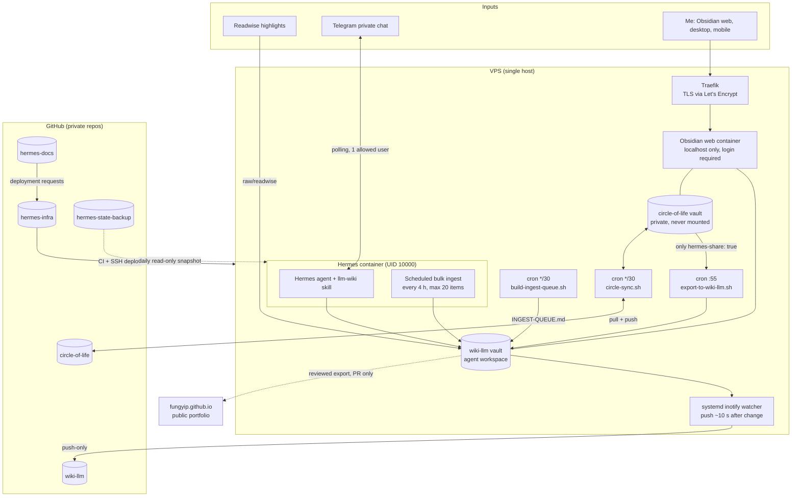
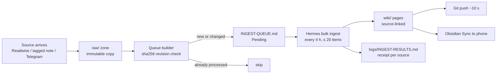
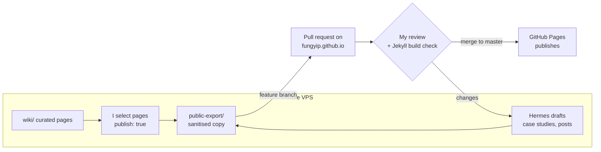

<style>.page__content .sidebar__right{float:none !important;width:auto !important;margin:0 0 2em 0 !important;position:static !important}</style>




> Treating personal knowledge like a data platform: governed ingestion, a bronze-to-curated pipeline run by an AI agent, CI/CD-controlled infrastructure, and a reviewed path to a public GitHub Pages portfolio.

| Project | Detail |
|---|---|
| **Stack** | VPS · Docker Compose · Traefik · Hermes agent · Obsidian · Readwise · Telegram · GitHub Actions · Jekyll / GitHub Pages |
| **Role** | Sole designer, builder and operator (personal project) |
| **Period** | 30 September 2026 – present |
| **Status** | Core platform running; deployment automation partly live; public publishing path proposed |
| **Last updated** | 24 October 2026 |

> **Publication note.** This page describes a private system. Hostnames, user IDs, domains, key names and repository links have been generalised. Every capability is tagged with one of four status labels so a design is never mistaken for a tested system:
> `LIVE` running and verified · `BUILT` implemented, not yet verified end to end · `PROPOSED` designed, not built · `OPEN` known gap.

---

## 1. Executive Summary

I built a single-VPS "knowledge data platform" that turns articles, highlights and selected personal notes into a curated, source-linked Markdown wiki, maintained by a self-hosted AI agent (Hermes) and readable in Obsidian on any device.

The design borrows directly from my day job in data architecture (data mesh, serverless data lakes, SAP ingestion):

| Data-platform concept | Implementation in this project |
|---|---|
| Source systems | Readwise highlights, Telegram messages, tagged personal notes |
| Bronze / raw zone | `wiki-llm/raw/` — append-only source copies |
| Data contract | `SCHEMA.md` — page structure and linking rules |
| IAM / guardrails | Container mounts, UID/GID file ownership, restricted agent toolsets |
| Job manifest | `INGEST-QUEUE.md` — built by a host script, not by the agent |
| Processing engine | Hermes `llm-wiki` skill, run on a 4-hour schedule |
| Curated layer | `wiki/` — compiled knowledge pages |
| Pipeline run log | `logs/INGEST-RESULTS.md` — one receipt per processed source |
| Infrastructure as code | `hermes-infra` repo with CI, tests and two deploy workflows |
| Publishing / consumption | GitHub Pages portfolio (fungyip.github.io), fed by a reviewed export |

**Key outcomes so far**

- **Hard privacy boundary.** The personal vault is never mounted into the agent container. Only notes with `hermes-share: true` in their frontmatter are copied, hourly, into the agent's workspace — and are removed again when the tag is removed. A CI test fails the build if the private vault ever appears in the Compose file. `LIVE`
- **Idempotent, content-addressed ingestion.** Each source is queued with its SHA-256 revision, so unchanged files are never re-processed and edited files are re-queued automatically. `LIVE`
- **Change-controlled host operations.** Merging a change to host scripts triggers a validated, backed-up, verified install on the VPS. First production apply: 23 October 2026. `LIVE`
- **Versioned everything.** Both vaults, the infrastructure, the documentation and the agent's skills/personality (`SOUL.md`) are backed up to separate private GitHub repositories; the agent-state snapshot ran successfully on 23 October 2026. `LIVE`
- **A clear path to public output.** The portfolio site receives only reviewed, sanitised exports through pull requests — the agent never pushes to the live site. `PROPOSED`

---

## 2. Problem and Goals

### The problem
{: .no_toc}

My learning spans data architecture, cloud platforms and agentic AI. Information arrived from many places — Readwise highlights, Telegram notes to myself, an Obsidian journal — but it stayed fragmented. Summaries were easy to generate and hard to trust: I couldn't see what source a claim came from, whether a page reflected the latest version of a source, or whether the AI had touched notes it should not see.

### Goals
{: .no_toc}

1. Ingest sources from several channels into one governed workspace.
2. Have an AI agent compile them into linked, source-referenced pages on a schedule.
3. Enforce privacy with **infrastructure controls**, not prompt instructions.
4. Make every change versioned, reviewable and recoverable.
5. Publish a curated subset to my personal website without exposing the private system.

### Non-goals (first release)
{: .no_toc}

- No public chatbot or public access to the live agent.
- No vector database or graph database — linked Markdown first.
- No automatic publication of the whole vault.
- No claim of full disaster recovery until a restore drill passes.

---

## 3. Architecture

### 3.1 System context
{: .no_toc}



<details markdown="1">
<summary>Plain-text version (for renderers without Mermaid)</summary>

```text
 Readwise ─┐                       ┌───────────────── VPS ──────────────────┐
 Telegram ─┼──────────────────────▶│ Traefik ─▶ Obsidian web (localhost)    │
 Me ───────┘                       │                                         │
                                   │ circle-of-life (private) ──X── Hermes   │
                                   │        │ hermes-share: true only        │
                                   │        ▼                                │
                                   │ wiki-llm/raw ─▶ INGEST-QUEUE ─▶ Hermes  │
                                   │                                  │      │
                                   │                          wiki/ + logs/  │
                                   └─────────────┬───────────────────┬──────┘
                                                 │ git push          │ reviewed export (proposed)
                                                 ▼                   ▼
                                   GitHub private repos      fungyip.github.io
```
</details>

### 3.2 The knowledge pipeline (bronze → curated)
{: .no_toc}



The key design choice: **the agent does not decide what to ingest.** A root-owned host script writes the queue; the agent can only work through it and must leave a receipt. That mirrors the separation between an orchestrator's job manifest and the compute that executes it.

### 3.3 Security boundaries
{: .no_toc}

| Asset | Who can access | Enforced by | Status |
|---|---|---|---|
| Private vault `circle-of-life` | Me; host backup and exporter scripts | Not mounted into Hermes; CI boundary test | `LIVE` |
| Agent vault `wiki-llm` | Me, Hermes, host jobs, Obsidian Sync | Only vault in the Compose mounts | `LIVE` |
| `AGENTS.md`, `SCHEMA.md`, `INGEST-QUEUE.md` | Hermes read-only (intended) | root ownership + file modes | `BUILT` |
| Telegram | One numeric user ID | `TELEGRAM_ALLOWED_USERS` allowlist | `LIVE` |
| Shell / code / cron from Telegram | Nobody | Restricted Telegram toolset | `LIVE` |
| Agent secrets (LLM keys, bot token) | Hermes runtime | VPS-only `.env`; CI secret scan | `LIVE` |
| Deploy SSH key | GitHub Actions `production` environment | Dedicated deploy user, single sudo command | `LIVE` |

> **Rule I designed around:** mounts, file ownership, tool switches and logins are the real locks. `AGENTS.md` is guidance a model can ignore.

### 3.4 Repository topology
{: .no_toc}

| Repository | Role | Visibility |
|---|---|---|
| `hermes-infra` | Executable code: Compose file, host scripts, tests, CI, deploy workflows | Private |
| `hermes-docs` | Architecture, ADRs, change plans, runbooks, deployment requests | Private |
| `hermes-state-backup` | Daily snapshot of agent `skills/` and `SOUL.md` | Private |
| `wiki-llm` | Push-only backup of the agent vault | Private |
| `circle-of-life` | Two-way backup of the personal vault | Private |
| `fungyip.github.io` | Jekyll (Minimal Mistakes) portfolio, published by GitHub Pages | Public |

Separating **code**, **documentation**, **state** and **content** means each repo has its own permissions, history and blast radius. The public site never shares a repository — or a credential — with the private system.

---

## 4. Technical Challenges

### Challenge 1 — Keeping a private vault private on the same server
{: .no_toc}

**Problem.** Both vaults live on one VPS, and the agent has file tools. An instruction such as "don't read my journal" is not a control.

**Approach.** Remove the private vault from the container's filesystem entirely, then add a one-way, opt-in export: a host script copies only notes whose frontmatter contains `hermes-share: true`, preserves folder structure, and deletes the copy when the tag is removed. A CI test fails if the Compose file ever mounts the private vault.

**Trade-off.** Sharing is hourly, not instant, and requires a deliberate tag. That friction is the point.

### Challenge 2 — Permission failures between containers
{: .no_toc}

**Problem.** Hermes runs as UID `10000`; the Obsidian container runs as UID `1000`. Early on, agent writes failed silently or produced files Obsidian could not edit.

**Approach.** Explicit ownership per folder instead of `chmod 777`: agent-writable `wiki/` and `logs/` are owned by `10000`; policy and queue files are root-owned and read-only. Every deployment now proves the agent can still write by creating and deleting a test file in `wiki/`, `logs/` and `inbox/` as UID `10000`.

### Challenge 3 — Avoiding duplicate and stale processing
{: .no_toc}

**Problem.** Readwise re-exports files; notes get edited. Re-running the agent on unchanged content wastes tokens; missing an edit leaves pages stale.

**Approach.** Content addressing. The queue builder hashes each source (`sha256`) and skips any path + revision already present in the queue or the results log. An edited source gets a new revision and is re-queued. A bug fix on 23 October corrected where new items were inserted in the queue; verification found no misfiled items.

### Challenge 4 — Making a single VPS safe to change
{: .no_toc}

**Problem.** Hand-edited servers drift from their documentation; a bad change on a single host has no failover.

**Approach.** Two separate deployment paths:

- **Host-script CD** `LIVE` — merging to `main` validates the exact commit, installs only allowlisted scripts via one sudo-permitted installer, backs up replaced files to a timestamped folder, and verifies every live file matches the repo.
- **Container deploy** `BUILT` — manual dispatch only, requires a full 40-character commit SHA and an `@sha256` image digest (never `:latest`), serialises deployments, uses strict SSH host-key checking, and runs write and HTTP smoke tests.

**Honest limitation.** The container workflow has never been run. It still needs the Traefik-to-Hermes routing fix (Traefik uses host networking, Hermes a bridge network) and a smoke-test URL.

### Challenge 5 — Backing up an agent's evolving "self"
{: .no_toc}

**Problem.** Hermes changes its own skills over time. Losing them means losing learned behaviour; backing them up carelessly can leak secrets embedded in skill files.

**Approach.** A scheduled GitHub Action pulls a single read-only `tar` stream over SSH (compatible with a forced-command key), validates the archive (no path traversal, links, duplicates or special files), replaces the snapshot exactly — including deletions — and runs a secret-pattern guard before committing. An initial scan of the raw state surfaced hundreds of secret-pattern hits in third-party reference files, which is why the guard and narrow scope exist.

**Scope.** `skills/` and `SOUL.md` only. An encrypted (age) private-state extension for memory, config and cron is written and tested locally (30 tests) but not yet merged or enabled. `PROPOSED`

### Challenge 6 — Documentation that can't silently go stale
{: .no_toc}

**Problem.** My runbook said "no deployment pipeline" while `deploy.yml` already existed.

**Approach.** Every claim in runbook v5.2 carries an evidence label — `[repo]`, `[live-<date>]`, `[unverified]` or `[proposed]` — so stale assertions are visible. This case study uses the same discipline.

---

## 5. Implementation Steps

The build happened in seven phases over about four weeks.

| Date (2026) | Phase | Milestone |
|---|---|---|
| 30 Sep | 1. Isolate | Agent mount narrowed to `wiki-llm`; agent port unpublished; Obsidian bound to localhost; Telegram polling with one-user allowlist and restricted tools; secrets cleanup |
| 1 Oct | 2. Version | inotify watcher pushes `wiki-llm` ~10 s after changes; `circle-sync.sh` every 30 min |
| 2 Oct | 3. Pipeline | LLM-wiki structure (`AGENTS.md`, `SCHEMA.md`, `index.md`, `log.md`, `wiki/`); ~60 Readwise files in `raw/readwise/`; ingest queue + builder |
| 3–4 Oct | 4. Share + sync | `hermes-share` exporter; Obsidian Sync for mobile; infra repo + CI |
| 15–18 Oct | 5. Codify | Host scripts imported to the repo with a test harness; deploy-time write tests; docs repo with deploy/recover/verify runbooks |
| 20–23 Oct | 6. Back up state | Daily agent-state snapshot workflow; hardened snapshot logic (PR #2); first successful live run |
| 23 Oct | 7. Host CD | Host-script continuous deployment live; first apply installed the queue fix |
| Next | 8. Publish | Reviewed export to fungyip.github.io (section 7) |

### Step 1 — Run the agent with a single, explicit vault mount
{: .no_toc}

```yaml
# apps/hermes/compose.yaml (domain generalised)
services:
  hermes-agent:
    image: ${HERMES_IMAGE:-<registry>/hermes-agent:latest}
    restart: unless-stopped
    expose:
      - "4860"                     # internal only; no host port published
    labels:
      - traefik.enable=true
      - traefik.http.routers.${COMPOSE_PROJECT_NAME}.rule=Host(`${COMPOSE_PROJECT_NAME}.${TRAEFIK_HOST}`)
      - traefik.http.routers.${COMPOSE_PROJECT_NAME}.entrypoints=websecure
      - traefik.http.routers.${COMPOSE_PROJECT_NAME}.tls.certresolver=letsencrypt
      - traefik.http.services.${COMPOSE_PROJECT_NAME}.loadbalancer.server.port=4860
    env_file:
      - ${HERMES_ENV_FILE:-/docker/<project>/data/.env}   # secrets stay on the VPS
    volumes:
      - ./data:/opt/data
      - /root/obsidian/vaults/wiki-llm:/opt/data/obsidian/wiki-llm   # the ONLY vault
```

### Step 2 — Set ownership so the agent can write only where it should
{: .no_toc}

```bash
cd /root/obsidian/vaults/wiki-llm
chown -R 10000:10000 wiki logs                 # agent-writable
find wiki logs -type d -exec chmod 775 {} \;
find wiki logs -type f -exec chmod 664 {} \;
chown root:root INGEST-QUEUE.md && chmod 644 INGEST-QUEUE.md   # host-owned manifest
chmod 444 AGENTS.md SCHEMA.md                  # policy + contract: read-only
```

### Step 3 — Opt-in export from the private vault
{: .no_toc}

```bash
#!/usr/bin/env bash
# host/bin/export-to-wiki-llm.sh  — runs from root cron at minute 55
set -euo pipefail
SRC="${CIRCLE_SRC:-/root/obsidian/vaults/circle-of-life}"
DST="${EXPORT_DST:-/root/obsidian/vaults/wiki-llm/raw/circle-of-life}"
mkdir -p "$DST"; cd "$SRC"

# True only if frontmatter starts on line 1 and contains `hermes-share: true`
is_shared() {
  awk 'NR==1{if($0!="---")exit 1;fm=1;next}
       fm&&$0=="---"{exit found?0:1}
       fm&&$0~/^hermes-share:[[:space:]]*true[[:space:]]*$/{found=1}
       END{if(!fm||!found)exit 1}' "$1"
}

# Copy tagged notes, preserving folders
while IFS= read -r -d '' f; do
  if is_shared "$f"; then
    rel="${f#./}"; mkdir -p "$DST/$(dirname "$rel")"
    install -m 0640 "$f" "$DST/$rel"
  fi
done < <(find . -type f -name '*.md' -not -path './.git/*' -not -path './.obsidian/*' -print0)

# Remove copies whose source was deleted or un-tagged
while IFS= read -r -d '' c; do
  rel="${c#"$DST/"}"
  [[ -f "$SRC/$rel" ]] && is_shared "$SRC/$rel" || rm -f -- "$c"
done < <(find "$DST" -type f -name '*.md' -print0)

find "$DST" -mindepth 1 -type d -empty -delete
if [[ -z "${EXPORT_SKIP_CHOWN:-}" ]]; then chown -R 10000:1000 "$DST"; fi
```

A note becomes visible to the agent only when I add:

```yaml
---
title: Reflections on data contracts
hermes-share: true
---
```

### Step 4 — Content-addressed ingest queue
{: .no_toc}

```bash
# host/obsidian/scripts/build-ingest-queue.sh (excerpt) — cron */30
while IFS= read -r -d '' abs_path; do
  rel_path="${abs_path#"$VAULT"/}"
  revision="sha256:$(sha256sum "$abs_path" | awk '{print $1}')"

  # Skip if this exact revision is already queued or already processed
  if grep -Fq "\`$rel_path\`" "$QUEUE" && grep -Fq "$revision" "$QUEUE"; then continue; fi
  if [[ -f "$RESULTS" ]] && grep -Fq "source: $rel_path" "$RESULTS" \
                         && grep -Fq "revision: $revision" "$RESULTS"; then continue; fi

  cat >> "$tmp_new" <<BLOCK
- [ ] \`$rel_path\`
  - depth: standard
  - focus: extract durable ideas and practical implications
  - origin: readwise
  - queued: $NOW
  - revision: $revision

BLOCK
done < <(find "$SOURCE_ROOT" -type f -name '*.md' -print0 | sort -z)
```

The agent is driven by short command words rather than open-ended prompts:

| Command | Meaning |
|---|---|
| `INGEST: <path>` | Compile one named source |
| `BULK-INGEST: STANDARD` | Work through the queue (scheduled every 4 h, ≤ 20 items) |
| `QUERY:` | Answer from the wiki; save only if asked |
| `LINT:` | Report-only health check |
| `CURATE:` | Explicit, file-named edits I have approved |

### Step 5 — Version both vaults automatically
{: .no_toc}

```bash
#!/bin/bash
# host/obsidian/scripts/circle-sync.sh — private vault, cron */30
cd "${CIRCLE_SYNC_DIR:-/root/obsidian/vaults/circle-of-life}" || exit 1
exec 9>"${CIRCLE_SYNC_LOCK:-/tmp/circle-sync.lock}"
flock -n 9 || exit 0                      # never overlap runs
git pull --rebase --autostash -q
if [ -n "$(git status --porcelain)" ]; then
  git add -A
  git commit -q -m "vault: $(date '+%F %H:%M') - $(git diff --cached --name-only | wc -l) files"
fi
git push -q
```

The agent vault uses a systemd `inotifywait` watcher with a 10-second quiet period, plus a daily timer as a safety net. It is push-only: nothing pulls from GitHub, so the VPS stays the single source of truth.

### Step 6 — Validate every change in CI
{: .no_toc}

```yaml
# .github/workflows/validate.yml (excerpt)
on: [pull_request, workflow_dispatch, workflow_call]
permissions:
  contents: read
jobs:
  validate:
    runs-on: ubuntu-latest
    steps:
      - uses: actions/checkout@v4
      - name: Bash syntax
        run: find apps host tests -name "*.sh" -print0 | xargs -0 -r -n1 bash -n
      - name: ShellCheck
        run: sudo apt-get install -y shellcheck && find apps host tests -name "*.sh" -print0 | xargs -0 -r shellcheck
      - name: Validate Compose
        run: bash tests/validate-compose.sh
      - name: Private vault must never be mounted
        run: bash tests/test-hermes-boundaries.sh
      - name: No secrets committed
        run: bash tests/test-no-secrets.sh
      - name: Host-script behaviour tests
        run: |
          bash tests/test-export-to-wiki-llm.sh
          bash tests/test-build-ingest-queue.sh
          bash tests/test-circle-sync.sh
```

### Step 7 — Deploy only pinned, immutable versions
{: .no_toc}

```yaml
# .github/workflows/deploy.yml (guards excerpt)
on:
  workflow_dispatch:
    inputs:
      ref:   { required: true, type: string, description: "Full 40-char commit SHA" }
      image: { required: true, type: string, description: "image@sha256:<digest>" }

concurrency:
  group: production-deploy
  cancel-in-progress: false        # queue, never cancel or overlap

jobs:
  validate:
    steps:
      - name: Enforce exact commit SHA
        run: grep -Eq '^[0-9a-f]{40}$' <<< "${{ inputs.ref }}" || exit 1
      - name: Enforce immutable image (never :latest)
        run: grep -Eq '@sha256:[0-9a-f]{64}$' <<< "${{ inputs.image }}" || exit 1
  deploy:
    needs: validate
    environment: production
    steps:
      # ... strict host-key SSH, compose upload, docker pull, compose up ...
      - name: Prove the agent can still write (as UID 10000)
        run: |
          docker compose exec -T --user 10000 hermes-agent sh -ec '
            for folder in wiki logs inbox; do
              f=$(mktemp "/opt/data/obsidian/wiki-llm/$folder/.ci-write-test.XXXXXX")
              echo ok > "$f" && rm "$f" && echo "$folder: write test passed"
            done'
```

Never-allowed commands on the VPS, written into the recovery runbook: `docker compose down -v`, `docker volume rm`, `docker image prune`, `docker system prune`.

### Step 8 — Snapshot the agent's skills and personality daily
{: .no_toc}

```yaml
# hermes-state-backup/.github/workflows/snapshot-state.yml (excerpt)
on:
  schedule:
    - cron: "0 20 * * *"           # 20:00 UTC = 04:00 Hong Kong
  workflow_dispatch:
jobs:
  snapshot:
    steps:
      - name: Pull read-only snapshot over SSH
        run: |
          ssh -i "$HOME/.ssh/state_key" -o StrictHostKeyChecking=yes -o BatchMode=yes \
            "$SSH_USER@$SSH_HOST" "tar -czf - -C $REMOTE_DIR skills SOUL.md" \
            > "$RUNNER_TEMP/snapshot.tgz"
      - name: Validate and apply (rejects traversal, links, special files)
        run: python3 scripts/apply-snapshot.py "$RUNNER_TEMP/snapshot.tgz"
      - name: Commit if changed, after secret guard
        run: |
          git add -A -- skills SOUL.md
          git diff --cached --quiet && exit 0
          bash scripts/check-snapshot-secrets.sh
          git commit -m "Snapshot Hermes skills and SOUL $(date -u '+%Y-%m-%dT%H:%MZ')"
          git push
```

Optional hardening for the VPS-side key — it can only ever run the snapshot:

```text
command="tar -czf - -C /docker/<project>/data skills SOUL.md",no-pty,no-agent-forwarding,no-X11-forwarding ssh-ed25519 AAAA... state-snapshot
```

---

## 6. VPS Hosting Setup

### 6.1 Why a VPS rather than managed hosting
{: .no_toc}

| Requirement | Why a VPS fits |
|---|---|
| Long-running agent with scheduled jobs | Full root access, Docker, cron and systemd |
| Private data on infrastructure I control | Vaults stay on my server; nothing is shared with a SaaS knowledge tool beyond the LLM API calls |
| Low fixed cost for a personal project | One host runs agent, Obsidian web UI, reverse proxy and host jobs |
| Fast start | A prebuilt Hermes container image and Docker templates |

The trade-off is that a single VPS is a single point of failure, which is why backups, provider snapshots before risky changes, and documented recovery matter more than in a managed setup.

### 6.2 Host layout
{: .no_toc}

```text
/docker/<project>/                    Hermes Compose project
├── compose.yaml                      deployed from hermes-infra
└── data/                             agent runtime (mounted at /opt/data)
    ├── .env                          secrets — VPS only, never in Git
    ├── SOUL.md                       agent personality  → hermes-state-backup
    └── skills/                       learned skills     → hermes-state-backup

/root/obsidian/vaults/
├── wiki-llm/                         agent workspace    → GitHub (push-only)
│   ├── AGENTS.md  SCHEMA.md          policy + contract (read-only)
│   ├── INGEST-QUEUE.md               job manifest (host-owned)
│   ├── raw/readwise/                 bronze: Readwise
│   ├── raw/circle-of-life/           bronze: opt-in personal notes (Git-ignored)
│   ├── wiki/                         curated pages (agent-writable)
│   └── logs/INGEST-RESULTS.md        receipts
└── circle-of-life/                   private vault      → GitHub (two-way)

/root/bin/, /root/obsidian/scripts/   host scripts installed by host-config CD
/usr/local/sbin/hermes-*              allowlisted installer
/var/backups/hermes-host-config/<UTC>/  pre-change copies of replaced scripts
```

### 6.3 Scheduled jobs
{: .no_toc}

| Job | Schedule | Runs as | Status |
|---|---|---|---|
| `export-to-wiki-llm.sh` | hourly at :55 | root cron | `BUILT` (re-verification pending) |
| `build-ingest-queue.sh` | every 30 min | cron | `BUILT` |
| Hermes bulk ingest | every 4 h, ≤ 20 items | Hermes cron | `BUILT` |
| `wiki-llm` Git watcher | ~10 s after a change + daily timer | systemd | `LIVE` |
| `circle-sync.sh` | every 30 min | root cron | `LIVE` |
| Agent-state snapshot | daily 04:00 HKT | GitHub Actions | `LIVE` |

### 6.4 Host-config continuous deployment
{: .no_toc}

```text
PR merged to main (changes under host/)
        │
        ▼
validate.yml re-runs on the exact commit
        │
        ▼
SSH as a dedicated deploy user (no password; one sudo rule)
        │
        ▼
sudo /usr/local/sbin/hermes-install-host-config --bundle <commit>
   ├── install only paths in host/manifest.tsv and the allowlist
   ├── back up replaced files → /var/backups/hermes-host-config/<UTC>/
   └── verify every live file matches the repo
        │
        ▼
Rollback = re-run the workflow in apply mode with an earlier SHA
```

```text
# host/manifest.tsv — TAB-separated: repo_path  live_path  default_owner  mode
host/bin/export-to-wiki-llm.sh                  /root/bin/export-to-wiki-llm.sh                 root:root     0700
host/obsidian/scripts/build-ingest-queue.sh     /root/obsidian/scripts/build-ingest-queue.sh    ubuntu:ubuntu 0700
host/obsidian/scripts/circle-sync.sh            /root/obsidian/scripts/circle-sync.sh           ubuntu:ubuntu 0755
```

The deploy account is deliberately **not** in the `docker` group (Docker group membership is effectively root), and its key lives only in the GitHub `production` environment.

---

## 7. Personal GitHub Page Integration

### 7.1 Current state
{: .no_toc}

fungyip.github.io is a Jekyll site using the Minimal Mistakes theme, published by GitHub Pages' classic build from the `master` branch. Navigation currently lists Data Science, Econometrics, Code and Post. The content predates this project, so it does not yet show my data-architecture or agent work.

### 7.2 Integration principle
{: .no_toc}

**The private VPS is the workshop; GitHub Pages is the public showroom.** The agent may draft; only I publish.



| Responsibility | Me | Hermes | GitHub |
|---|---|---|---|
| Choose what becomes public | Decide | Suggest | — |
| Draft pages | Supply facts | Draft, flag gaps as TODO | — |
| Verify claims and status labels | Approve | — | — |
| Open the PR | `PROPOSED`: automated later | Prepare branch locally | — |
| Merge and publish | Only me | Never | Pages build |

### 7.3 Proposed site structure
{: .no_toc}

```text
fungyip.github.io/
├── _config.yml
├── _data/navigation.yml           ← add Projects and Knowledge
├── _pages/
│   ├── projects.md                ← project index
│   ├── knowledge.md               ← demo knowledge collection index
│   └── ...existing pages
├── _projects/                     ← new Jekyll collection
│   └── knowledge-data-platform.md ← this case study
├── _knowledge/                    ← 5–10 reviewed wiki pages
└── assets/images/projects/        ← exported diagram PNG/SVGs
```

### 7.4 Code: navigation and collections
{: .no_toc}

```yaml
# _data/navigation.yml
main:
  - title: "Projects"
    url: /projects/
  - title: "Knowledge"
    url: /knowledge/
  - title: "Data Science"
    url: /datascience/
  - title: "Econometrics"
    url: /econometrics/
  - title: "Post"
    url: /posts/
```

```yaml
# _config.yml (additions)
collections:
  projects:
    output: true
    permalink: /projects/:name/
  knowledge:
    output: true
    permalink: /knowledge/:name/

defaults:
  - scope: { path: "", type: projects }
    values: { layout: single, author_profile: true, toc: true, toc_sticky: true }
  - scope: { path: "", type: knowledge }
    values: { layout: single, author_profile: false, share: false }
```

```markdown
<!-- _pages/projects.md -->
---
title: "Projects"
permalink: /projects/
layout: collection
collection: projects
entries_layout: grid
---
Selected work in data architecture, agentic AI and knowledge systems.
```

Mermaid is not rendered by Minimal Mistakes out of the box. Either export diagrams to SVG with `mmdc`, or add the script to `_includes/footer/custom.html`:

```html
<!-- _includes/footer/custom.html -->
<script type="module">
  import mermaid from "https://cdn.jsdelivr.net/npm/mermaid@10/dist/mermaid.esm.min.mjs";
  // kramdown + Rouge wraps ```mermaid blocks in div.language-mermaid
  document.querySelectorAll("div.language-mermaid, pre > code.language-mermaid").forEach(el => {
    const block = el.matches("div") ? el : el.parentElement;
    const div = document.createElement("div");
    div.className = "mermaid";
    div.textContent = block.textContent;
    block.replaceWith(div);
  });
  mermaid.initialize({ startOnLoad: true });
</script>
```

### 7.5 Code: export script on the VPS `PROPOSED`
{: .no_toc}

Only pages I explicitly mark with `publish: true` leave the private system, and a sanitiser blocks anything that looks private.

```bash
#!/usr/bin/env bash
# /root/bin/export-to-site.sh — run manually; never on a schedule (yet)
set -euo pipefail
WIKI="/root/obsidian/vaults/wiki-llm/wiki"
SITE="/root/site/fungyip.github.io"      # separate clone, separate deploy key
OUT="$SITE/_knowledge"
BRANCH="content/$(date +%Y%m%d-%H%M)"

git -C "$SITE" fetch -q origin && git -C "$SITE" switch -q -c "$BRANCH" origin/master
mkdir -p "$OUT"

grep -rlZ --include='*.md' '^publish: true$' "$WIKI" | while IFS= read -r -d '' f; do
  # Block anything that references private paths, hosts or secrets
  if grep -Eiq '<private-vault>|<vps-hostname>|api[_-]?key|token|BEGIN .*PRIVATE KEY' "$f"; then
    echo "BLOCKED (sanitiser): $f" >&2; continue
  fi
  # Convert Obsidian [[wikilinks]] to site links
  sed -E 's/\[\[([^]|]+)\|([^]]+)\]\]/[\2](\/knowledge\/\1\/)/g; s/\[\[([^]]+)\]\]/[\1](\/knowledge\/\1\/)/g' \
      "$f" > "$OUT/$(basename "$f")"
done

git -C "$SITE" add _knowledge
git -C "$SITE" diff --cached --stat
echo "Review the diff above, then: git -C $SITE commit -m 'Add reviewed knowledge pages' && git -C $SITE push -u origin $BRANCH"
```

### 7.6 Code: build check on every PR `PROPOSED`
{: .no_toc}

Pages' classic build only runs on `master`, so a PR check catches broken Liquid, front matter or links before merge.

```yaml
# fungyip.github.io/.github/workflows/pr-build.yml
name: Build check
on: pull_request
permissions:
  contents: read
jobs:
  build:
    runs-on: ubuntu-latest
    steps:
      - uses: actions/checkout@v4
      - uses: ruby/setup-ruby@v1
        with: { ruby-version: "3.1", bundler-cache: true }
      - name: Build site
        run: bundle exec jekyll build --strict_front_matter
      - name: Check internal links
        run: |
          gem install html-proofer
          htmlproofer ./_site --disable-external --allow-hash-href
      - name: Block private references
        run: |
          ! grep -rEi '<private-vault>|<vps-hostname>' _site/knowledge
```

### 7.7 Rollout plan
{: .no_toc}

1. Add `Projects` and `Knowledge` navigation and collections in a branch; confirm the existing pages still build.
2. Publish this case study as the first project, with diagrams exported to SVG.
3. Hand-select five `wiki/` pages, mark `publish: true`, run the export, review, merge.
4. Rewrite the homepage introduction around current work (data architecture, agentic AI, knowledge systems).
5. After two or three clean manual cycles, let Hermes prepare the branch — still with me opening and merging the PR.

---

## 8. Results and Evidence

| Evidence | Result | Status |
|---|---|---|
| Private vault absent from agent container | Confirmed in live survey (11 Oct) and enforced by CI boundary test | `LIVE` |
| Host-config CD first production apply | Installed the queue fix on 23 Oct; live files verified against repo | `LIVE` |
| Agent-state snapshot | Manual live run succeeded 23 Oct; daily schedule active | `LIVE` |
| Snapshot hardening | 15 regression tests; exact replacement incl. deletions | `LIVE` |
| Encrypted private-state backup | 30 local tests pass; not merged or VPS-tested | `PROPOSED` |
| Readwise ingestion | ~60 source files loaded into `raw/readwise/` | `LIVE` |
| Queue integrity after fix | No unchecked items found in the wrong section | `LIVE` |
| Container deploy workflow | Written and validated in CI; never run | `BUILT` |
| Full restore drill | Not yet performed | `OPEN` |

I have not published accuracy figures for the agent's knowledge pages yet. The next step is a ten-question evaluation (direct, cross-source, missing-information and updated-evidence questions, scored 0–2) on a public demo collection.

---

## 9. Lessons Learned

1. **Controls belong outside the model.** The most important security decision was a missing volume mount, not a well-written prompt.
2. **Data-platform patterns transfer to personal knowledge.** Bronze/curated zones, job manifests, content hashing and run logs made the agent's work auditable.
3. **Separate repos by purpose.** Code, docs, state and content change at different speeds and need different permissions.
4. **Pin everything you deploy.** A commit SHA and image digest make "what is running" a fact, not a guess.
5. **Label your evidence.** Tagging claims as live, built, proposed or open stopped my own documentation from overstating the system.
6. **Backups are not recovery.** Until a restore drill passes, I call them snapshots.

## 10. Known Gaps and Next Steps

| Item | Status | Next action |
|---|---|---|
| Traefik (host network) ↔ Hermes (bridge network) routing | `OPEN` | Attach Hermes to Traefik's network or proxy via host port bound to localhost |
| Container deploy first run | `BUILT` | Set `COMPOSE_DIR`, `SMOKE_TEST_URL`; grant Docker access deliberately |
| Revoke old GitHub PATs, rotate keys | `OPEN` | Complete security checklist |
| Old agent cron jobs referencing the private vault | `OPEN` | Audit and remove |
| Encrypted private-state backup | `PROPOSED` | Offline age identity, restore drill, then enable |
| Crontab and systemd units under version control | `OPEN` | Extend host-config manifest |
| Public knowledge collection and evaluation | `PROPOSED` | Section 7.7 |


